# Mineração de métricas DORA em repositórios públicos

**Disciplina:** Laboratório de Experimentação de Software  
**Professor:** Danilo Maia  
**Grupo:** Ana, Bruna e Walter  
**Repositório:** [github.com/bruna-bernardes/Lab_Experimentacao_Software](https://github.com/bruna-bernardes/Lab_Experimentacao_Software)

## 1. Introdução

As métricas DORA avaliam velocidade e estabilidade da entrega de software. Este estudo calcula essas métricas a partir de repositórios públicos do GitHub que usam GitHub Actions. Uma release publicada é o proxy de deploy, uma execução de workflow é o proxy de integração contínua e a data do autor do commit é a origem do lead time. Como o GitHub não registra deploys nem incidentes de produção, os valores são aproximações e a classificação depende da definição operacional adotada.

### 1.1 Questões de pesquisa e hipóteses

**RQ01.** Qual a frequência de deploy dos repositórios populares que usam CI/CD? Esperamos grande dispersão entre projetos.

**RQ02.** Qual o tempo entre commit e deploy? Esperamos que a variante por release seja maior que a variante por commit, porque ela usa o commit mais antigo de cada release.

**RQ03.** Qual a taxa de falha? Esperamos diferenças entre o proxy de falha de CI e o proxy de releases corretivas.

**RQ04.** Qual o tempo de recuperação? Esperamos heterogeneidade entre os repositórios.

**RQ05.** Frequência maior implica maior taxa de falha? Esperamos que velocidade e estabilidade não apresentem uma relação monotônica forte.

**RQ06.** Quais características estão associadas ao desempenho? Esperamos associações com linguagem, popularidade e idade.

**RQ07.** A classificação depende da definição operacional? Esperamos que parte dos repositórios mude de categoria entre variantes.

## 2. Metodologia

### 2.1 Amostra e coleta

A janela de observação vai de 1º de outubro de 2025 a 30 de setembro de 2026 (cerca de 52,1 semanas). Entraram repositórios públicos, não arquivados e que não são forks, com mais de 1.000 estrelas, GitHub Actions, pelo menos cinco releases publicadas e pelo menos 50 workflow runs válidas no branch padrão, disparadas por `push`. A busca foi fatiada por faixas de estrelas e o pool foi embaralhado com semente 42. O pipeline pediu 320 repositórios para manter margem sobre o mínimo de 300.

| Etapa | Repositórios |
|---|---:|
| População da busca | 60.162 |
| Candidatos examinados | 2.255 |
| Sem GitHub Actions | 934 |
| Com GitHub Actions | 1.320 |
| Menos de 5 releases | 886 |
| Menos de 50 runs válidas | 114 |
| Erros persistentes | 1 |
| **Amostra final** | **320** |

Drafts ficaram de fora. A definição principal de deploy usa releases com `prerelease = false`. A data do commit é `commit.author.date`. Runs com conclusão `cancelled`, `skipped`, `neutral`, `action_required`, `stale` ou vazia foram ignoradas. Falha de CI reúne `failure`, `timed_out` e `startup_failure`.

No lead time, 59 releases foram a primeira da história do repositório e ficaram de fora dessa métrica. Outras 15, em 12 repositórios, não tiveram comparação disponível. Houve 5.330 releases com comparação e nenhum commit novo, e 402 commits com data posterior à publicação, descartados do cálculo.

### 2.2 Definições operacionais

A frequência de deploy é o número de releases da janela dividido por 52,1 semanas. O lead time por release é a mediana, entre as releases, da diferença entre `published_at` e o commit mais antigo incluído na release. O lead time por commit é a mediana de `published_at` menos a data de cada commit incluído. O CFR de CI é a proporção de runs com falha entre falhas e sucessos. O CFR de entrega é a proporção de releases seguidas, em até 7 dias, por uma release corretiva. Releases dos últimos 7 dias da janela ficam fora do denominador: foram 547 releases, em 105 repositórios. O tempo de recuperação é a mediana, por repositório, da diferença entre o `updated_at` do primeiro sucesso e o `run_started_at` da primeira falha do episódio, dentro de cada workflow.

A heurística do dataset (versão v1) marca a release seguinte como corretiva quando a versão muda apenas o *patch* e há ao menos um commit com `fix`, `hotfix`, `bugfix` ou `revert`. Se a tag não segue o versionamento semântico, a decisão usa só as mensagens.

Todas as estatísticas descritivas usam mediana e intervalo interquartil. A classificação DORA usa os cortes fixos da disciplina:

| Métrica | Elite | High | Medium | Low |
|---|---|---|---|---|
| Frequência | ≥ 7 por semana | ≥ 1 e < 7 por semana | ≥ 1 por mês e < 1 por semana | < 1 por mês |
| Lead time | < 1 dia | 1 dia a < 1 semana | 1 semana a < 30 dias | ≥ 30 dias |
| Change failure rate | ≤ 15% | > 15% e ≤ 30% | > 30% e ≤ 45% | > 45% |
| Recuperação | < 1 hora | 1 hora a < 1 dia | 1 dia a < 1 semana | ≥ 1 semana |

A categoria geral atribui 4 pontos a Elite, 3 a High, 2 a Medium e 1 a Low. O resultado é a mediana desses pontos, arredondada para baixo. Quando não há episódio de recuperação encerrado, a mediana usa as métricas disponíveis.

### 2.3 Amostra-ouro

A amostra-ouro tem 60 repositórios sorteados com `random_state = 42` e 300 releases (cinco por repositório). Três avaliadores rotularam, de forma independente, o tipo do projeto, se as releases representam entregas reais e se cada release sorteada é corretiva. O consenso usou unanimidade, maioria simples e, nos empates 1-1-1, decisão de reunião registrada em `validacao/decisoes_reuniao.csv`.

| Dimensão | n | Kappa de Fleiss | Interpretação | Concordância unânime |
|---|---:|---:|---|---:|
| Tipo de projeto | 60 | 0,518 | moderada | 80,0% |
| Entregas reais | 60 | −0,040 | pobre | 40,0% |
| Release corretiva | 300 | 0,369 | razoável | 52,7% |

O consenso de tipo reuniu 48 rótulos unânimes e 12 por maioria: 54 bibliotecas ou frameworks, 5 aplicações ou serviços e 1 ferramenta de linha de comando. O consenso de entregas reais reuniu 24 unânimes, 32 por maioria e 4 decisões de reunião: 51 sim, 5 incerto e 4 não. O consenso de releases corretivas reuniu 158 unânimes e 142 por maioria.

| Versão | Regra | Precisão | Recall | F1 |
|---|---|---:|---:|---:|
| v1 | patch e ao menos um commit de correção | 0,833 | 0,611 | 0,705 |
| v2 | patch e pelo menos metade dos commits de correção | 0,810 | 0,198 | 0,318 |
| v3 | apenas mudança de patch | 0,828 | 0,756 | 0,790 |

O dataset e as análises usam a versão v1.

## 3. Resultados

As figuras e as tabelas desta seção foram geradas por `python analise_sprint3.py` e estão em `resultados/sprint3/`.

### 3.1 RQ01 — Frequência de deploy

A mediana foi **0,345 releases por semana**, o que corresponde a **18 releases** na janela. O primeiro quartil foi 0,173 (9 releases), o terceiro foi 0,901 (47 releases) e o IQR foi 0,729. A distribuição é assimétrica: a maior parte da amostra publica menos de uma release por semana, e poucos repositórios passam de uma por dia.

| Elite | High | Medium | Low |
|---:|---:|---:|---:|
| 6 | 61 | 132 | 121 |

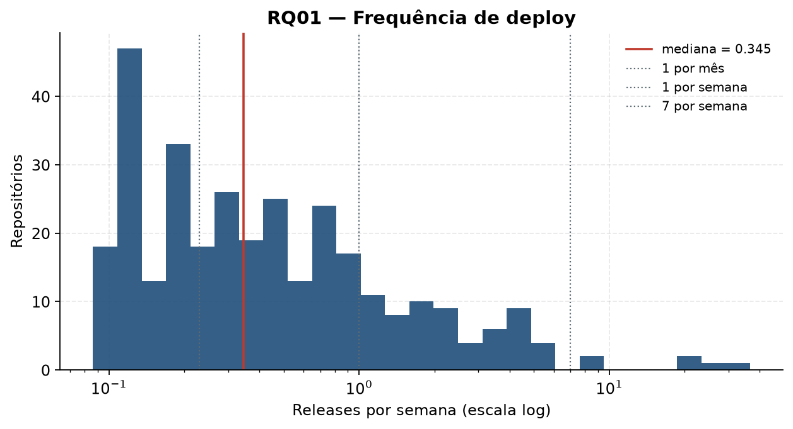

### 3.2 RQ02 — Lead time

| Variante | n | Mediana | Q1 | Q3 | IQR |
|---|---:|---:|---:|---:|---:|
| Por release | 320 | 245 h (10,2 dias) | 41 h (1,7 dia) | 761 h (31,7 dias) | 720 h |
| Por commit | 320 | 193 h (8,1 dias) | 45 h (1,9 dia) | 674 h (28,1 dias) | 628 h |

As duas medianas caem na faixa Medium (de uma semana a menos de 30 dias). A variante por release é maior, como previsto: um commit antigo eleva o valor da release inteira, enquanto a variante por commit dilui esse efeito entre todos os commits.

Na variante por release, 65 repositórios são Elite, 69 High, 105 Medium e 81 Low.

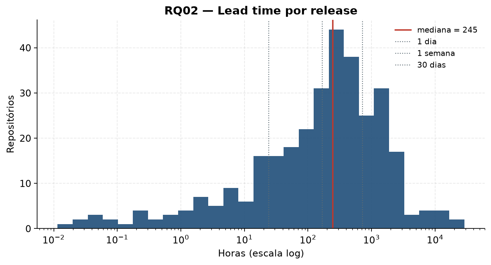

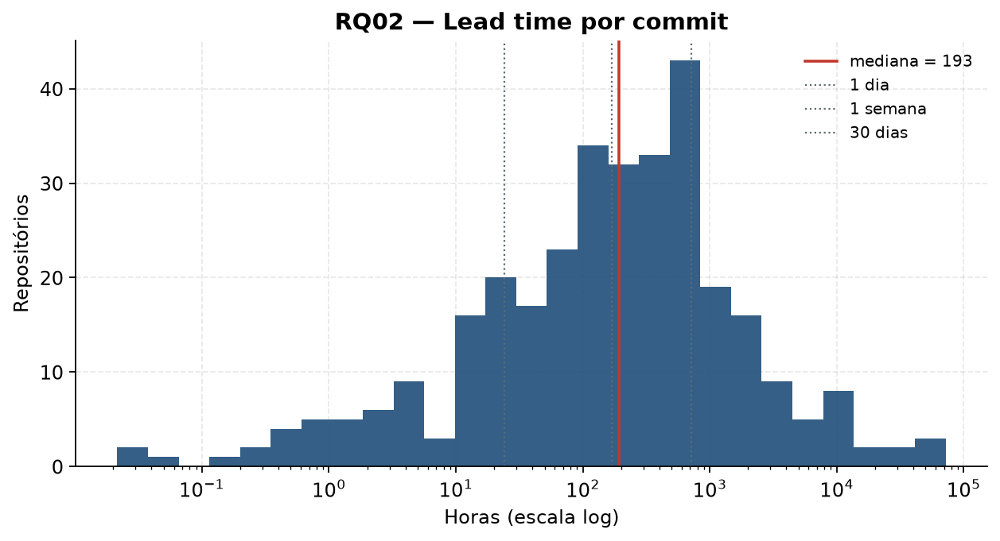

### 3.3 RQ03 — Change failure rate

| Variante | n | Mediana | Q1 | Q3 | IQR |
|---|---:|---:|---:|---:|---:|
| CFR de CI | 320 | 4,8% | 2,1% | 12,2% | 10,1 p.p. |
| CFR de entrega | 320 | 14,3% | 0% | 33,3% | 33,3 p.p. |

O CFR de CI tem mediana Elite e é concentrado: 253 repositórios ficam em até 15%. O CFR de entrega tem mediana também Elite, no limite da faixa, e é bem mais disperso: 165 Elite, 64 High, 47 Medium e 44 Low. Falha de pipeline e release corretiva produzem distribuições diferentes.

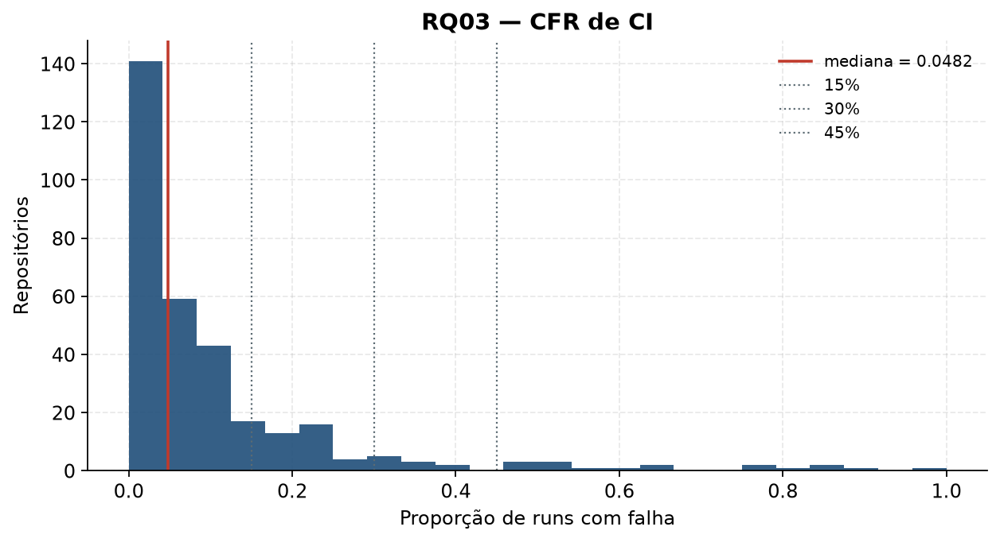

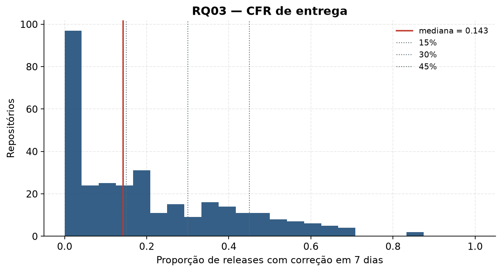

### 3.4 RQ04 — Tempo de recuperação

Houve mediana em 292 repositórios: **3,06 horas**, com Q1 de 0,87 hora, Q3 de 16,8 horas e IQR de 15,9 horas. A mediana cai na faixa High (de 1 hora a menos de 1 dia). Dos episódios observados, 15.918 foram encerrados por um sucesso e 116 permaneceram abertos até o fim da janela (0,7% dos episódios), em 71 repositórios. Vinte e oito repositórios não tiveram episódio encerrado e ficam sem mediana.

| Elite | High | Medium | Low | Sem episódio encerrado |
|---:|---:|---:|---:|---:|
| 80 | 157 | 46 | 9 | 28 |

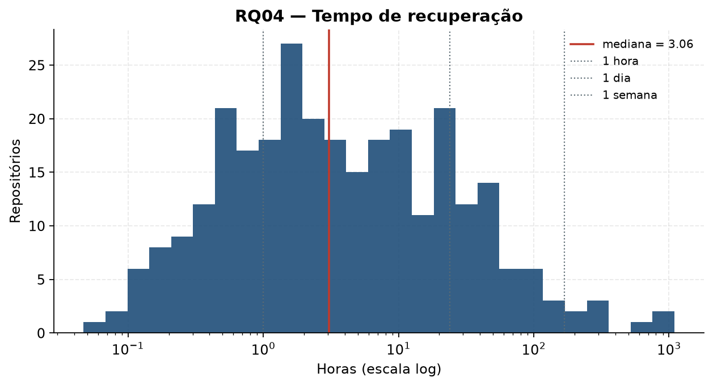

### 3.5 Classificação de referência

Na combinação C1 (frequência, lead time por release, CFR de CI e recuperação), a categoria geral dos 320 repositórios é:

| Elite | High | Medium | Low |
|---:|---:|---:|---:|
| 25 (7,8%) | 125 (39,1%) | 142 (44,4%) | 28 (8,8%) |

A figura abaixo separa as quatro métricas. A estabilidade medida pelo CI concentra a amostra em Elite e High. A velocidade, sobretudo a frequência, concentra a amostra em Medium e Low. A categoria geral, que usa a mediana das quatro notas, fica por isso em Medium ou High para a maior parte dos repositórios.

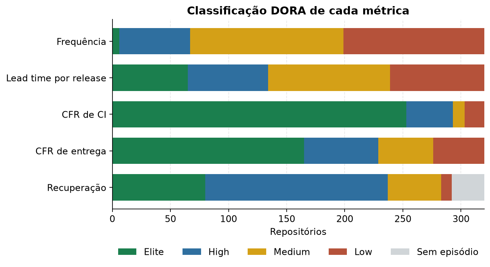

### 3.6 RQ05 — Frequência e taxa de falha

| CFR | n | Spearman ρ | p-valor |
|---|---:|---:|---:|
| CI | 320 | 0,072 | 0,197 |
| Entrega | 320 | 0,422 | < 0,001 |

Não há associação monotônica detectável entre frequência e CFR de CI. Há associação positiva moderada entre frequência e CFR de entrega: repositórios que publicam mais vezes também tendem a ter mais releases seguidas por uma correção em até sete dias. A associação descreve a ordem dos valores e não estabelece causa.

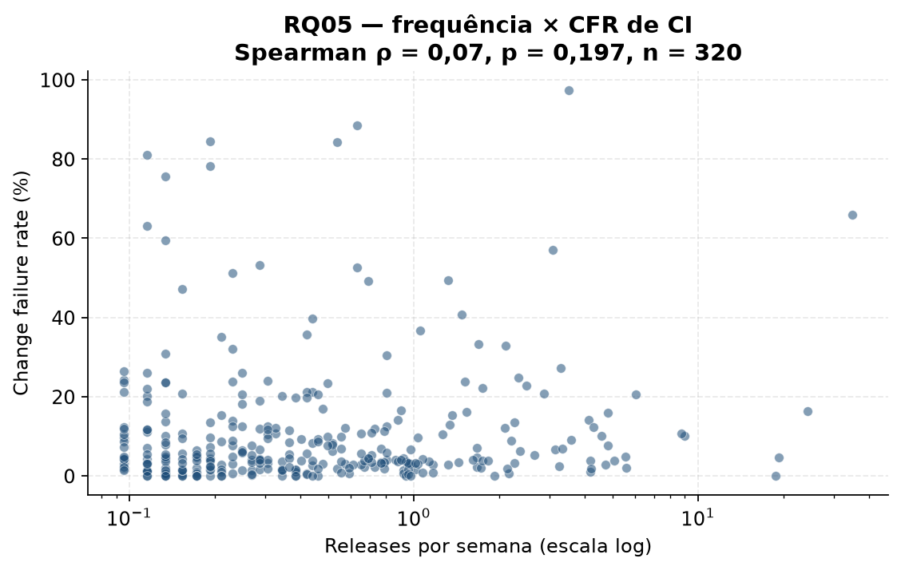

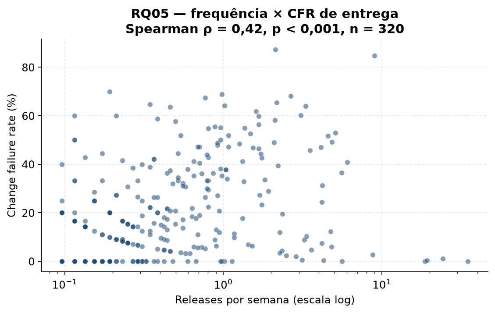

### 3.7 RQ06 — Características associadas

Os fatores foram a linguagem principal, os quartis de estrelas, os quartis de idade e o tipo de projeto da amostra-ouro. Para cada fator e cada métrica aplicou-se Kruskal-Wallis, ou Mann-Whitney quando havia dois grupos. Os 24 p-valores foram corrigidos por Holm. O tamanho de efeito do Kruskal-Wallis é ε² = H / (n − 1).

Permaneceram significativas, com p de Holm inferior a 0,001:

| Fator | Métrica | ε² |
|---|---|---:|
| Linguagem | Frequência | 0,157 |
| Linguagem | Lead time por release | 0,174 |
| Linguagem | Lead time por commit | 0,154 |
| Idade | Frequência | 0,144 |
| Idade | Lead time por release | 0,215 |
| Idade | Lead time por commit | 0,214 |
| Idade | CFR de entrega | 0,193 |

Os quartis de estrelas não mostraram diferença significativa em nenhuma métrica. O quartil menos popular vai de 1.011 a 1.501 estrelas e o mais popular, de 8.616 a 213.942.

Entre as linguagens com pelo menos 10 repositórios, a mediana de frequência vai de 0,74 release por semana em TypeScript (78 repositórios) a 0,13 em C++ (11). Java, C# e C ficam próximas de 0,19.

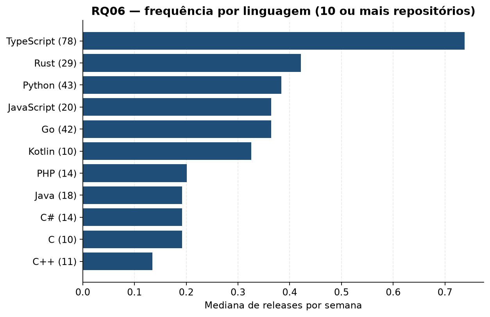

A idade vai, no quartil mais novo, de 7 a 723 dias e, no mais antigo, de 3.647 a 6.316 dias. As medianas de frequência nesses quartis são 0,78, 0,44, 0,35 e 0,19 release por semana. As medianas de lead time por release são 48, 241, 322 e 877 horas. As medianas de CFR de entrega são 33%, 14%, 14% e 0%. Repositórios mais novos publicam com mais frequência, com lead time menor e com mais releases corretivas em até sete dias.

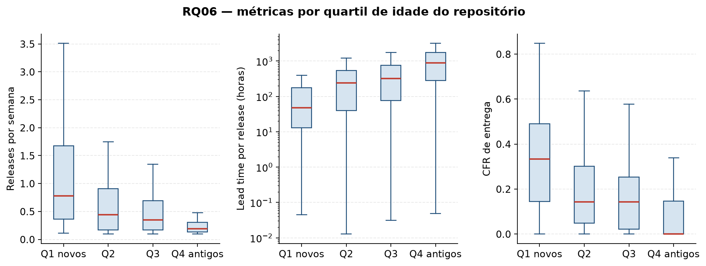

Na amostra-ouro, a comparação entre as 5 aplicações ou serviços e as 54 bibliotecas ou frameworks não permaneceu significativa após Holm em nenhuma métrica. A ferramenta de linha de comando é um único repositório.

### 3.8 RQ07 — Sensibilidade da classificação

Três combinações usam as variantes já calculadas no dataset:

| Combinação | Lead time | CFR |
|---|---|---|
| C1 | por release | de CI |
| C2 | por commit | de entrega |
| C3 | por release | de entrega |

A frequência e o tempo de recuperação são os mesmos nas três. A categoria geral muda assim:

| Comparação | Mudaram de categoria | Percentual | Kappa ponderado |
|---|---:|---:|---:|
| C1 × C2 | 108/320 | 33,8% | 0,52 |
| C1 × C3 | 71/320 | 22,2% | 0,70 |
| C2 × C3 | 57/320 | 17,8% | 0,73 |

| Combinação | Elite | High | Medium | Low |
|---|---:|---:|---:|---:|
| C1 | 25 | 125 | 142 | 28 |
| C2 | 11 | 111 | 172 | 26 |
| C3 | 12 | 98 | 182 | 28 |

O kappa entre 0,52 e 0,73 indica concordância de moderada a substancial. A maior troca ocorre quando lead time e CFR mudam ao mesmo tempo. Trocar só o proxy de falha, de C1 para C3, move 22,2% dos repositórios e reduz a parcela High de 125 para 98, engrossando a parcela Medium.

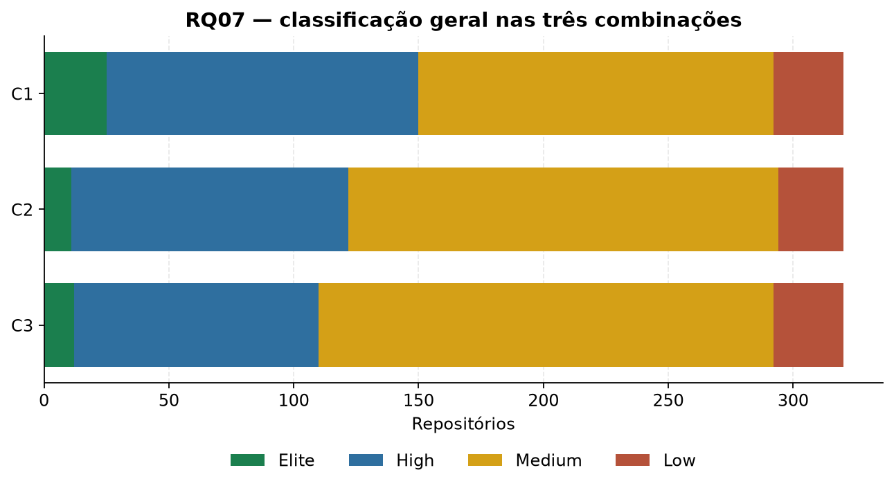

## 4. Discussão

A dispersão prevista na frequência aparece nos números: o intervalo entre o primeiro e o terceiro quartil vai de 9 a 47 releases no ano, e 253 dos 320 repositórios ficam abaixo de uma release por semana. A hipótese do lead time também se confirma. A mediana por release (10,2 dias) supera a mediana por commit (8,1 dias), e as duas continuam na mesma faixa DORA.

Os dois CFRs respondem a perguntas diferentes. O de CI tem mediana de 4,8% e coloca 253 repositórios em Elite. O de entrega tem mediana de 14,3% e IQR de 33 pontos percentuais. A hipótese de que os proxies divergem fica sustentada pela classificação e pela correlação. Frequência e CFR de CI têm ρ = 0,07 (p = 0,197). Frequência e CFR de entrega têm ρ = 0,42 (p < 0,001). No proxy de pipeline, velocidade e estabilidade caminham sem uma relação monotônica. No proxy de release corretiva, publicar mais vezes acompanha uma taxa maior de correções em até sete dias. Isso é compatível com políticas de release diferentes, e a correlação não indica que deploys frequentes causem falhas de produção.

Linguagem e idade separam os grupos; a popularidade, dentro da faixa acima de 1.000 estrelas, não. O efeito mais claro é o da idade: projetos mais novos concentram frequência mais alta, lead time mais curto e CFR de entrega mais alto. Os ε² significativos ficam entre 0,14 e 0,21. São associações de grupo, não efeitos causais.

Na classificação geral de referência, 44,4% dos repositórios são Medium e 39,1% são High. Esse resultado mistura uma estabilidade de CI alta com uma frequência baixa. Entre as três combinações, de 17,8% a 33,8% dos repositórios mudam de categoria. A ordenação relativa se mantém em boa parte (kappa de 0,52 a 0,73), e a etiqueta Elite, High, Medium ou Low de um repositório precisa nomear a definição que a produziu.

## 5. Ameaças à validade

**Construto.** Release publicada aproxima deploy, e falha de workflow aproxima falha em produção. Na amostra-ouro, o consenso considerou que as releases representam entregas reais em 51 dos 60 repositórios, com 5 incertos e 4 negativos. A concordância dessa dimensão foi pobre (κ = −0,04), então o próprio critério é ambíguo. A heurística v1, usada no CFR de entrega, tem precisão de 0,83, recall de 0,61 e F1 de 0,70 frente ao consenso, e o kappa entre avaliadores nessa dimensão foi 0,37.

**Interna.** Idade e linguagem estão associadas às métricas, e a análise não separa esses fatores de política de release, tamanho da equipe ou número de workflows. Rebases e *squash merges* podem alterar `commit.author.date`; 402 commits tiveram data posterior à publicação e foram descartados. Repositórios mais antigos acumulam mais história de release, o que pode alongar o lead time por release.

**Externa.** A amostra reúne 320 projetos públicos com mais de 1.000 estrelas, extraídos de uma busca com 60.162 repositórios. Projetos privados, corporativos ou menos populares podem ter outro ritmo de release e outro uso de GitHub Actions.

**Conclusão.** A correção de Holm reduz o risco de falso positivo nas 24 comparações da RQ06. O tipo de projeto foi observado em 60 repositórios, com 54 bibliotecas ou frameworks. Mediana e IQR foram escolhidos porque as distribuições são assimétricas. A classificação geral muda para 17,8% a 33,8% dos repositórios quando a variante de lead time ou o proxy de falha muda, então uma conclusão presa a uma única etiqueta DORA é sensível a essa escolha.

## 6. Materiais

O pipeline roda, a partir de `Laboratorio_03`, com:

```text
python -m pipeline --config config.json
```

O token é lido da variável `GITHUB_TOKEN`. O dataset está em `resultados/dataset_final.csv` e o dicionário de colunas em `resultados/dicionario_dados.md`. A subamostra fixa de 30 repositórios, sorteada com semente 42, está em `resultados/replicacao/amostra_30.csv`.

## 7. Conclusão

Nos 320 repositórios, a frequência mediana é de 18 releases em doze meses e o lead time mediano fica entre 8 e 10 dias, conforme a variante. O CFR de CI tem mediana de 4,8% e o de entrega, de 14,3%. O tempo mediano de recuperação é de 3,06 horas. A categoria geral mais comum na definição de referência é Medium (142 repositórios), seguida de High (125).

Velocidade e falha de CI não se associam. Velocidade e release corretiva se associam de forma positiva e moderada. Linguagem e idade acompanham diferenças de frequência e de lead time; a contagem de estrelas, dentro desta amostra, não. De 17,8% a 33,8% dos repositórios mudam de categoria DORA quando a definição de lead time ou de falha muda.

## Referências

- Forsgren, N.; Humble, J.; Kim, G. *Accelerate: The Science of Lean Software and DevOps*. IT Revolution, 2018.
- DORA. *Software delivery metrics: the four keys*. https://dora.dev/guides/dora-metrics-four-keys/
- Wohlin, C. et al. *Experimentation in Software Engineering*. Springer, 2012.
- Landis, J. R.; Koch, G. G. The measurement of observer agreement for categorical data. *Biometrics*, 1977.
- Romano, J. et al. Appropriate statistics for ordinal level data. 2006.
